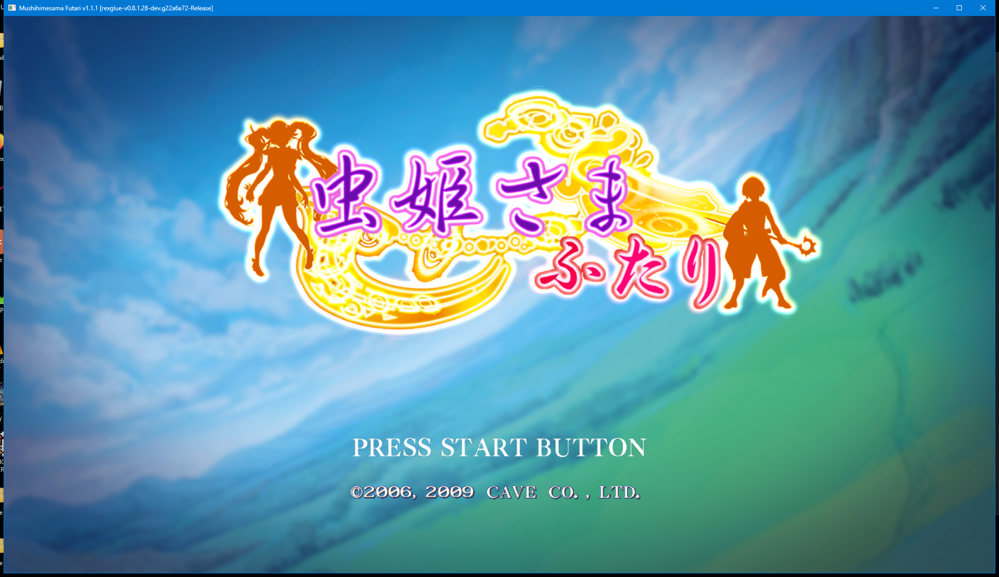

# futari_recomp

> ⚠️ **Disclaimer — built with heavy use of AI.** The recompilation, port code,
> tooling, and documentation in this repo were developed largely with the assistance
> of AI coding tools (large language models). It's a hobby project: verify things
> yourself before relying on them, and expect rough edges. No warranty.

Static recompilation of **Mushihimesama Futari Ver. 1.5** (Xbox 360, 2006/2012)
for native PC execution, built on the [ReXGlue SDK](https://github.com/rexglue/rexglue-sdk).

> **This repository contains no copyrighted game files.**
> You must own a legal copy of the game and extract the assets yourself.



**Latest release:** v1.3.2 (Windows + Steam Deck + macOS).

Per-OS build/status details live in [PORTS.md](PORTS.md); the macOS bundle scripts
are in [`mac-build/`](mac-build/).

The Xbox 360 PowerPC code is translated ahead-of-time to C++ and linked against
the ReXGlue runtime (a Xenia-derived layer providing the kernel, a D3D12/Vulkan
GPU, XMA audio, input, and a virtual filesystem). `default.xex` is the
shell/menu; each game mode is a separate module XEX that's recompiled into its
own DLL and loaded on demand.

**Status:** boots to the title and full menu; all 8 game-mode modules load and
mode-switching works. Some gameplay paths still hit recompiler edge cases — see
[Known issues](#known-issues).

---

## Prerequisites

| Tool | Version | Notes |
|------|---------|-------|
| CMake | 3.25+ | |
| Ninja | any | `winget install Ninja-build.Ninja` |
| LLVM / clang-cl | 20+ (validated on 22) | Standalone [LLVM](https://github.com/llvm/llvm-project/releases) — the build uses the **clang-cl** (MSVC) driver |
| Windows SDK | 10/11 | Provides `rc.exe` (resource compiler) |
| Python | 3.8+ | Extraction scripts |
| Git + Bash | any | Submodules; `scripts/regen.sh` is a bash script |

> This project builds with **clang-cl** (MSVC ABI), not `clang++`. The scaffolded
> CMake presets default to `clang++` — the configure command below overrides
> them. A standalone LLVM install is assumed at `C:\Program Files\LLVM`.

---

## Build

### 1. Clone + the shared SDK
```sh
git clone --recurse-submodules <repo-url> futari_recomp
cd futari_recomp
```
futari's only submodule is `thirdparty/XenonRecomp`. The ReXGlue SDK is **not**
vendored here — it's the shared [`springah/rexglue-sdk`](https://github.com/springah/rexglue-sdk)
checkout (branch `main`, the same one the sibling recomps use). Clone it as a
sibling and point `REXSDK_DIR` at it (step 5):
```sh
git clone -b main https://github.com/springah/rexglue-sdk.git ../rexglue-sdk
```

### 2. Build the ReXGlue CLI
```sh
cmake -S ../rexglue-sdk -B ../rexglue-sdk/build -G Ninja \
  -DCMAKE_BUILD_TYPE=Release \
  -DCMAKE_C_COMPILER="C:/Program Files/LLVM/bin/clang-cl.exe" \
  -DCMAKE_CXX_COMPILER="C:/Program Files/LLVM/bin/clang-cl.exe"
cmake --build ../rexglue-sdk/build --target rexglue
# -> ../rexglue-sdk/out/win-amd64/rexglue.exe
```

### 3. Extract your game assets
```sh
python scripts/extract_iso.py "Mushihimesama Futari Ver 1.5.iso" --out assets/
```
This populates `assets/` with `default.xex` and `media/Module/*.xex`
(gitignored — never committed).

### 4. Generate the recompiled C++
```sh
bash scripts/regen.sh
```
This runs `rexglue codegen` for the shell and **each** game-mode module **in
isolation** (the SDK analyzer corrupts cross-module analysis when same-base
modules share one manifest — all 8 modes load at `0x88000000`), then assembles
`generated/default/module_registry.cpp` and `dll_targets.cmake` for all modules.
Inputs are [`futari_manifest.toml`](futari_manifest.toml) and the function-entry
hints in [`futari_functions.toml`](futari_functions.toml). Output lands in
`generated/` (gitignored).

### 5. Configure
```sh
cmake -S . -B out/build/win-amd64 -G Ninja -DCMAKE_BUILD_TYPE=Release \
  -DCMAKE_C_COMPILER="C:/Program Files/LLVM/bin/clang-cl.exe" \
  -DCMAKE_CXX_COMPILER="C:/Program Files/LLVM/bin/clang-cl.exe" \
  -DCMAKE_RC_COMPILER="C:/Program Files (x86)/Windows Kits/10/bin/<sdk-ver>/x64/rc.exe" \
  -DREXSDK_DIR="$PWD/../rexglue-sdk"
```
> Do **not** pass `-DCMAKE_CXX_FLAGS=...` — it clobbers CMake's default `/EHsc`
> and breaks exception-handling in dependencies. The required SSE baseline and
> `char8_t` flags are applied inside the SDK's own CMake.

### 6. Build (host + all module DLLs)
```sh
cmake --build out/build/win-amd64 --target futari \
  futari_reco_normal futari_reco_abnormal \
  futari_palm_normal futari_palm_abnormal \
  futari_hirow_normal futari_hirow_abnormal \
  futari_kiniro_normal futari_kiniro_abnormal
```

### 7. Run
```sh
out/build/win-amd64/futari.exe --game_data_root assets
```
`futari.exe` is a GUI (WIN32) app — it opens a window and logs to
`out/build/win-amd64/logs/futari_NNN.log`. Add `--log_level debug` for detail.

---

## Project layout

```
futari_recomp/
├── assets/                  # gitignored — your extracted game files
├── generated/               # gitignored — codegen output (see scripts/regen.sh)
├── futari_manifest.toml     # entrypoint + 8 [[modules]] game modes
├── futari_functions.toml    # function-entry hints for the shell
├── CMakeLists.txt           # links rex::runtime via generated/rexglue.cmake
├── src/
│   └── main.cpp             # REX_DEFINE_APP entry + ReXApp subclass + ini config
├── scripts/
│   ├── extract_iso.py       # XDVDFS ISO extractor
│   ├── analyse_xex.py       # XEX header / address inspector
│   └── regen.sh             # regenerate generated/ (per-module isolated codegen)
├── legacy/                  # gitignored — the old hand-rolled XenonRecomp runtime
└── thirdparty/
    └── XenonRecomp/         # submodule (recompiler tooling)
```
> The ReXGlue SDK is **not** under `thirdparty/` — it's the shared
> `springah/rexglue-sdk` checkout (branch `main`), referenced via `REXSDK_DIR`.

---

## Known issues

- **Jump-table traps.** Some gameplay paths (e.g. reco_abnormal character
  select) host-crash with `STATUS_ILLEGAL_INSTRUCTION` from
  `__builtin_trap(); // Switch case out of range` in a recompiled module —
  under-sized jump-table detection. Fix needs `[[switch_tables]]` hints or
  improved detection per table.
- **Shell edge case `0x820816EC`.** A function with a backward branch into
  itself that doesn't split cleanly; only crashes if that path runs.

---

## How it was built

A fuller account of the toolchain quirks (clang-cl flag spellings, the
multi-module isolation requirement, the module-unload path-matching fix, and
the function-hint workflow) lives in the agent memory file
`futari-recomp-sdk-build.md`.

---

## Credits

- [ReXGlue SDK](https://github.com/rexglue/rexglue-sdk) — Xbox 360 runtime + recompiler (Xenia-derived)
- [XenonRecomp](https://github.com/hedge-dev/XenonRecomp) — reference PPC → C++ recompiler
- [Xenia](https://github.com/xenia-project) — the emulator ReXGlue's runtime is rooted in
- [UnleashedRecomp](https://github.com/hedge-dev/UnleashedRecomp) — recomp reference project

Cave / CAVE Interactive Co., Ltd. own all rights to Mushihimesama Futari.
