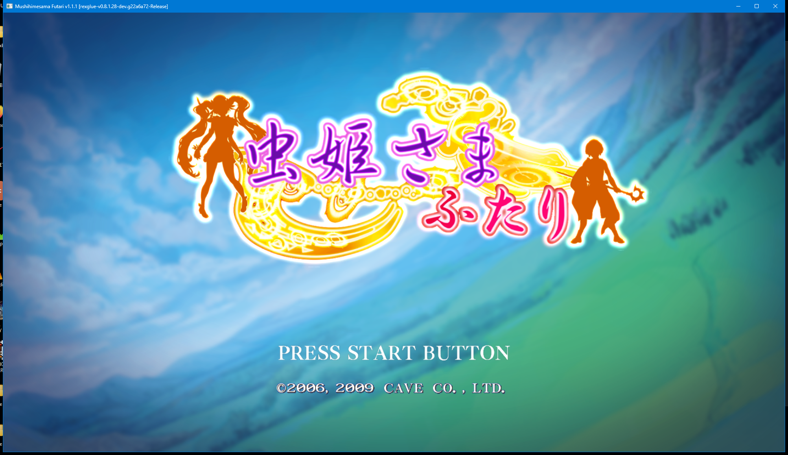

# futari_recomp

Static recompilation of **Mushihimesama Futari** (Xbox 360, 2006/2012) for native
PC execution, built on the [ReXGlue SDK](https://github.com/rexglue/rexglue-sdk).

> **No game data here.** No game executable, no `media/`, no audio, no artwork
> off the disc — you supply all of it yourself, from a copy you own; see
> [Game data](#game-data) and [docs/DUMPING.md](docs/DUMPING.md). The two
> exceptions are named in [NOTICE.md](NOTICE.md): a title screenshot and the
> application icon, both game-derived and both kept for identification only.

> ⚠️ **Built with heavy use of AI.** Code, tooling, and docs in this repo were
> written largely with LLM assistance. Hobby project — verify before relying on
> it, expect rough edges, no warranty.



**Latest release:** v1.5.8 (Windows, macOS): bundles on the
[GitHub release](https://github.com/springah/futari_recomp/releases/tag/v1.5.8);
history in [CHANGELOG.md](CHANGELOG.md), per-OS build and packaging details in
[PORTS.md](PORTS.md).

The exe has its own setup screen (unzip, double-click, point it at your own
dump; no Python), a settings screen on F2, and an opt-in second renderer,
Renut, beside the unchanged default one: see [Renderers](#renderers). With
Renut linked, the release binaries are distributed under the GPL-3.0; this
repository's own files stay BSD 3-Clause (see [Licence](#licence)).

**Linux and Steam Deck players: use [futari-linux](https://github.com/cerroverb/futari-linux)** instead.
From v1.5.4 on this project ships Windows and macOS only. futari-linux is a
native-renderer port of the same game maintained by cerroverb, and on a Steam
Deck it runs the game at a fraction of the CPU and power this one needs ([#6](https://github.com/springah/futari_recomp/issues/6)). The `linux-amd64` preset stays in the tree for anyone who wants
to build this version, but it is no longer a supported target.

**Status:** title, menus, audio, controller, and saves work, and all 8 game modes
load, run, and mode-switch cleanly. The known limits of the
new setup screen and of Renut, and the recompiler edge cases found so far (all
fixed), are under [Known issues](#known-issues). Deeper gameplay may still turn
up new ones.

## Just want to play?

Prebuilt bundles for Windows and macOS are attached to the
[GitHub Releases](https://github.com/springah/futari_recomp/releases). They
contain the game's own program code, recompiled, and are **for people who own
the game only** (see [Legal](#legal)); they contain no game data. Linux and
Steam Deck: [futari-linux](https://github.com/cerroverb/futari-linux).

- **Install:** unzip anywhere and double-click `futari.exe` (macOS:
  `Futari-<version>.app`). With no game data in place the setup screen asks for
  your own dump (disc ISO, the install folder copied off your console, or an
  already-extracted game folder), puts it in place, prepares the shaders for
  the optional Renut renderer and starts the game. No Python, no batch file.
- **Settings:** F2 in the game (renderer, fullscreen, vsync, window size, DLC,
  shaders), saved into `futari.ini`.
- **Upgrading:** copy `assets/`, `dlc/` and `futari.ini` into the new version's
  folder, start it, and if you use Renut press F2 and "Redo the shaders" once
  (the shader file names the build that made it).
- **Command line:** drag the same sources onto `extract_assets.bat` (needs
  Python 3). `RUN.txt` inside the zip has the details, the macOS steps included.

## How it works

The Xbox 360 PowerPC code is translated ahead-of-time to C++ and linked against
the ReXGlue runtime (a Xenia-derived layer providing the kernel, a D3D12/Vulkan
GPU, XMA audio, input, and a virtual filesystem). `default.xex` is the shell and
menu; each of the 8 game modes is a separate module XEX, recompiled into its own
DLL and loaded on demand.

Almost none of that C++ is in this repo — it's generated into `generated/` by
`scripts/regen.sh` from your own game dump, and gitignored. What's tracked here is
the host app (`src/main.cpp`), the codegen inputs (`*.toml`), and the build.

## Renderers

Two renderers are built into the exe. The **default** one is the SDK's
emulated Xenos GPU (Direct3D 12 on Windows, Vulkan over MoltenVK on macOS):
faithful, and heavy. **Renut** is opt-in: it draws the game's own Direct3D
calls directly through Vulkan with the game's own shaders, which is lighter on
the CPU and has less input lag. It is masterspike52's
[reNut](https://github.com/masterspike52/reNut), as ChanseyIsTheBest's
[futari-nx](https://github.com/ChanseyIsTheBest/futari-nx) taught it this game
and as cerroverb's [futari-linux](https://github.com/cerroverb/futari-linux)
carries it, vendored in `src/renut_engine/` under the GPL-3.0. It came in
answer to a game-speed report ([#8](https://github.com/springah/futari_recomp/issues/8))
and futari-linux's measurements on a Steam Deck
([#6](https://github.com/springah/futari_recomp/issues/6)).

- **Turning it on:** pick it on the F2 settings screen and Save, or put
  `futari_renderer = renut` at the top of `futari.ini` (above the first
  `[section]`), or start the exe with `--futari_renderer=renut`. Delete the
  line to go back.
- **Needs a Vulkan 1.2 driver.** Renut is Vulkan-only: its Direct3D 12 backend
  has no shaders to draw with.
- **Its shaders come from your game.** Shaders are game data, so no zip carries
  them: the setup screen (or `extract_assets.bat`) translates them from your own
  executables into `vulkan_spirv.bin` beside the exe, in a few seconds, with
  the translator built into `futari.exe`. Redo it after every update (F2,
  "Redo the shaders"); without the file, or with one from another version, the
  game starts on the default renderer for that session and the log and the F2
  screen say why. The default renderer does not need it.
- On macOS, Renut draws through MoltenVK (Vulkan over Metal), turned on the same
  way; the setup screen there has the shader step as well (the DirectX Shader
  Compiler ships inside the app, built from source). It renders at the window's
  1x size like the default renderer, and Apple GPUs have no geometry shaders,
  so rectangle lists go through tessellation there. The picture matches the
  default renderer, but treat it as experimental on the Mac: heavy scenes can
  drop below 60 fps (41 to 55 fps seen in Black Label on an M3 Max), where the
  default renderer holds 60.

## Game data

You supply the game yourself, from a copy you own. Two pieces:

**`assets/` — the disc (required).** From a release zip on Windows, the setup
screen in `futari.exe` does this for you (see [Just want to play?](#just-want-to-play)).
From a source build, or on the command line, the extractor takes a **Ver 1.5**
disc ISO, the install folder copied straight off your console's storage
(hash-verified, no conversion tools needed — see DUMPING.md), or an
already-extracted game folder (`default.xex` and `media/` at its top):

```sh
python scripts/extract_iso.py "Mushihimesama Futari Ver 1.5.iso" --out assets/
# or, from a console disc install (also installs your DLC into dlc/):
python scripts/extract_iso.py "path/to/435A07D7" --out assets/ --dlc-out dlc/
```

On Windows you can drag the `.iso`, that console folder or a loose game folder
onto [`extract_assets.bat`](extract_assets.bat) instead; it also translates the
Renut shaders when `futari.exe` is beside it. You should end up with
`assets/default.xex` and an `assets/media/` tree containing the 8 module XEXs.
The game reads `assets/` next to the exe; `--game_data_root <path>` points
elsewhere.

**`dlc/` — the marketplace DLC (optional).** The extractor installs these
automatically when it finds them next to a console install; or drop the Xbox 360
STFS packages into a `dlc/` folder next to the exe yourself, filenames unchanged.
They install themselves on first launch
(`DLC: InstallContent(...) -> 0x00000000` in the log). No `dlc/` folder just
means no extra content — the game runs fine without it.

📖 **[docs/DUMPING.md](docs/DUMPING.md)** walks through getting both off your own
console, and lists checksums to verify the result.

## Build

Needs CMake 3.25+, Ninja, **LLVM/clang-cl** 20+ (at `C:\Program Files\LLVM`),
**Visual Studio 2022 Build Tools** with the Desktop C++ workload (clang-cl targets
the MSVC ABI, so it needs those headers and libs — plus `rc.exe` from the bundled
Windows SDK), Python 3.8+ with the `xxhash` module (`pip install xxhash`; the
shader dump below needs it), and git + bash.

**Quick start (Windows):** [`build.ps1`](build.ps1) does all of the below in one
go. It installs whatever is missing from that list via winget, enters the Visual
Studio developer environment, builds the SDK CLI, extracts your game data, runs
codegen, configures and builds:

```powershell
git -c core.symlinks=true -c core.longpaths=true clone --recurse-submodules https://github.com/springah/futari_recomp
cd futari_recomp
.\build.ps1 -GameSource "D:\Mushihimesama Futari Ver 1.5.iso" -Run
```

`build.bat` is the same thing for a double-click. Git symlinks need **Developer
Mode** (Settings → System → For developers) or an elevated shell; the script
says so if it hits that.

The SDK at `thirdparty/rexglue-sdk` is **vendored** — this port owns and
maintains its own copy, taken from a fork of the
[upstream SDK](https://github.com/rexglue/rexglue-sdk) at v0.9.3.1 and carrying
the clang-cl and macOS fixes this port needs; see
[thirdparty/rexglue-sdk/VENDORED.md](thirdparty/rexglue-sdk/VENDORED.md) and
[PORTS.md](PORTS.md#sdk). Only the SDK's third-party dependencies are git
submodules, all pointing at their public upstreams.

The manual steps `build.ps1` automates:

```sh
# 1. Clone with the SDK's third-party submodules (~1 GB of dependency history;
#    do NOT add --shallow-submodules — several pins are not branch tips, and a
#    shallow clone silently leaves those submodules on the wrong commit).
#    The -c options go BEFORE `clone` so they reach the submodule clones too —
#    `git clone -c ...` only configures the parent repo.
git -c core.symlinks=true -c core.longpaths=true clone --recurse-submodules https://github.com/springah/futari_recomp
cd futari_recomp

# 2. Build the ReXGlue CLI
cmake -S thirdparty/rexglue-sdk -B thirdparty/rexglue-sdk/build -G Ninja \
  -DCMAKE_BUILD_TYPE=Release \
  -DCMAKE_C_COMPILER="C:/Program Files/LLVM/bin/clang-cl.exe" \
  -DCMAKE_CXX_COMPILER="C:/Program Files/LLVM/bin/clang-cl.exe"
cmake --build thirdparty/rexglue-sdk/build --target rexglue

# 3. Provide the game data — see "Game data" above (assets/, and dlc/ if you have it)
python scripts/extract_iso.py "Mushihimesama Futari Ver 1.5.iso" --out assets/

# 4. Generate the recompiled C++ into generated/, then dump the game's shaders
#    for the Renut renderer (out/renut_shader_dump; the configure step refuses
#    to run without it, or pass -DFUTARI_RENUT_STUB_SHADER_CACHE=ON for a
#    build whose Renut draws nothing)
bash scripts/regen.sh
bash scripts/renut_shader_dump.sh

# 5. Configure. Run from a "Developer PowerShell for VS 2022" so rc.exe is on
#    PATH; otherwise add -DCMAKE_RC_COMPILER="C:/Program Files (x86)/Windows Kits/10/bin/<sdk-ver>/x64/rc.exe".
#    The win-amd64-* presets use clang-cl from C:/Program Files/LLVM; pass
#    -DCMAKE_C_COMPILER/-DCMAKE_CXX_COMPILER if yours lives elsewhere.
cmake --preset win-amd64-release

# 6. Build everything — the exe plus all 8 module DLLs
cmake --build --preset win-amd64-release

# 7. Run (GUI app; logs to logs/futari_NNN.log next to the exe)
out/build/win-amd64-release/futari.exe --game_data_root assets
```

<details>
<summary><b>Gotchas worth knowing before you hit them</b></summary>

- **clang-cl, not clang++.** This builds against the MSVC ABI. The `win-*`
  presets name clang-cl for that reason; the SDK's own presets still default to
  `clang++`, which is why step 2 spells the compiler out.
- **`git -c core.symlinks=true` (before `clone`) matters.** The SDK's libmspack submodule uses
  git symlinks. Without it (plus Developer Mode), those files check out as text
  stubs and the SDK build fails with `lzxd.c(1,1): error: expected identifier`. Fix
  an affected checkout with `git -C <submodule> config core.symlinks true`, then
  re-checkout the files.
- **Don't pass `-DCMAKE_CXX_FLAGS=...`.** It clobbers CMake's default `/EHsc` and
  breaks exception handling in dependencies. The SSE baseline and `char8_t` flags
  are set inside the SDK's own CMake.
- **Build with no `--target`.** Naming only `futari` skips the 8 module DLLs, which
  then keep whatever flags they were last built with.
- **Codegen runs per-module in isolation.** All 8 modes load at `0x88000000`, and
  the SDK analyzer corrupts cross-module analysis if they share one manifest.
  `regen.sh` already handles this; don't collapse it into a single codegen pass.
- **The SDK is vendored, not pinned.** Builds use the `thirdparty/rexglue-sdk`
  tree in this repo. Pass `-DREXSDK_DIR=<path>` to build against a separate
  checkout instead.
- **`generated/` must exist before you configure.** `CMakeLists.txt` includes
  `generated/rexglue.cmake`, which step 4 produces. Configuring a fresh clone
  without running `scripts/regen.sh` first fails immediately, by design.

</details>

### macOS and Linux

Linux is build-from-source only and unsupported from v1.5.4 on (Linux and Steam
Deck players: see [futari-linux](https://github.com/cerroverb/futari-linux)); the preset is kept because it still
builds. The same seven steps, with a different compiler and preset. Needs CMake 3.25+,
Ninja, Python 3 and a recent clang: on macOS that is **Homebrew LLVM**
(`brew install llvm molten-vk`; the SDK rejects Apple's clang), on Linux the
distribution's clang 20+ plus the Vulkan headers and loader.

```sh
# 2. Build the ReXGlue CLI with the SDK's own configure preset for your platform
#    (mac-arm64 or linux-amd64). Name the compiler: the preset says a bare
#    `clang++`, which on macOS is Apple's, and the SDK refuses that. The CLI
#    lands in thirdparty/rexglue-sdk/out/<platform>/Release/, where regen.sh
#    looks for it. (Configured once with the wrong compiler? Delete
#    thirdparty/rexglue-sdk/out/build/<platform> before trying again.)
cmake --preset mac-arm64 -S thirdparty/rexglue-sdk   -DCMAKE_C_COMPILER=/opt/homebrew/opt/llvm/bin/clang   -DCMAKE_CXX_COMPILER=/opt/homebrew/opt/llvm/bin/clang++   # Linux: your clang/clang++
cmake --build thirdparty/rexglue-sdk/out/build/mac-arm64 --config Release --target rexglue

# 3.–4. as above (pip3 install xxhash first)
python3 scripts/extract_iso.py "Mushihimesama Futari Ver 1.5.iso" --out assets/
bash scripts/regen.sh
bash scripts/renut_shader_dump.sh

# 4b. macOS only, once: the Renut renderer's build needs Microsoft's shader
#     compiler, which has no macOS download; this builds it from source into
#     thirdparty/reblue-XenosRecomp/thirdparty/dxc-bin/ (a few minutes).
#     Or configure with -DFUTARI_RENUT_RENDERER=OFF for the default renderer only.
bash scripts/build_dxc_mac.sh

# 5.–7. configure, build, run
cmake --preset mac-arm64-release                        # or: linux-amd64-release
cmake --build --preset mac-arm64-release
out/build/mac-arm64-release/futari --game_data_root assets
```

On macOS, `mac-build/build_app.sh` turns that build directory into a
self-contained `Futari-<version>.app` (bundled MoltenVK, ad-hoc signed); its header lists
the paths it takes. [PORTS.md](PORTS.md) has the per-platform notes.

## Layout

```
assets/                   # gitignored — your extracted game files
dlc/                      # gitignored — your DLC packages
generated/                # gitignored — codegen output (scripts/regen.sh)
futari_functions.toml     # function-entry hints for the shell (default.xex)
<module>_functions.toml   # the same for each of the 8 game-mode modules
src/                      # host app: main.cpp (ReXApp subclass, futari.ini, title exit), ini_merge.h, icon
src/launcher/             # the setup and settings screens inside the exe (C++ extractor, shader pipeline, file pickers)
src/renut_engine/, src/renut_shim/, tools/renut/   # the Renut renderer (vendored, GPL-3.0), its shims, its shader tools
scripts/                  # extract_iso.py, make_shaders.py (ships in the zip), regen.sh, stage_win_zip.sh, notices generator
build.ps1, build.bat      # one-shot Windows build
extract_assets.bat        # drag-and-drop wrapper around extract_iso.py (also ships in the bundles, with make_shaders.py + renut_tools/)
mac-build/build_app.sh    # macOS .app packaging
dist/                     # files that ship inside release zips: RUN.txt, gamecontrollerdb.txt, dlc-README.txt
docs/                     # DUMPING.md (getting your own game data), NOTES_renut_*.md (the Renut port), NOTES_launcher.md, upstream/ (SDK notes)
PORTS.md, CHANGELOG.md    # per-OS build/release notes; version history
thirdparty/rexglue-sdk/   # the SDK, vendored (VENDORED.md); its deps are submodules
thirdparty/plume/, thirdparty/reblue-XenosRecomp/   # Renut's render interface and shader translator (MIT, vendored)
```

## Known issues

Known limits of v1.5.8:

- **Renut is Vulkan-only** (needs a Vulkan 1.2 driver; no Direct3D 12 path).
  On macOS it is experimental: the picture is right, but heavy scenes can run
  at 41 to 55 fps where the default renderer holds 60, because Apple GPUs have
  no geometry shaders and the tessellation that stands in for them costs a
  compute pass per draw call under MoltenVK.
- **The setup screen translates the shaders in one pass**, where
  `extract_assets.bat` (through `make_shaders.py`) runs two passes around an
  early-alpha rewrite. A few pixel shaders run slower from the setup screen's
  package; the picture is the same. Run the batch file with nothing dragged on
  to get the optimised package.

Two recompiler issues from earlier versions, both fixed: the shell's one
inexpressible branch (a pointer-scan false positive split `sub_82081658` at
`0x82081778`; the address is now declared a chunk of its parent in
`futari_functions.toml`), and host crashes on entering a game mode from
under-sized jump tables (fixed in the SDK's switch-table analysis).
[CHANGELOG.md](CHANGELOG.md) has the details.

## Credits

- [ReXGlue SDK](https://github.com/rexglue/rexglue-sdk) — Xbox 360 runtime + recompiler (Xenia-derived)
- [XenonRecomp](https://github.com/hedge-dev/XenonRecomp) — reference PPC → C++ recompiler
- [Xenia](https://github.com/xenia-project) — the emulator ReXGlue's runtime is rooted in
- [UnleashedRecomp](https://github.com/hedge-dev/UnleashedRecomp) — recomp reference project; parts of Renut's frame pacing come from it
- [reNut](https://github.com/masterspike52/reNut) by masterspike52: the Renut renderer itself, reused with its author's permission ([reNut#74](https://github.com/masterspike52/reNut/issues/74))
- [futari-nx](https://github.com/ChanseyIsTheBest/futari-nx) by ChanseyIsTheBest: the Switch port that taught Renut this game (by way of banjo-nx)
- [futari-linux](https://github.com/cerroverb/futari-linux) by cerroverb: the Linux port whose Renut is the one vendored here, and its release-shader model
- [XenosRecomp](https://github.com/hedge-dev/XenosRecomp) by hedge-dev, in reblue's fork as futari-linux carries it: the shader translator
- [plume](https://github.com/renderbag/plume) by renderbag: the render interface Renut draws with

Also worth a look: [SDOJ-Recomp](https://github.com/eandis/SDOJ-Recomp) — a recomp
of another CAVE Xbox 360 shooter, DoDonPachi SaiDaiOuJou.

## Legal

Mushihimesama Futari, and all of its code, data, audio, and artwork, are the
property of Cave Interactive Co., Ltd. This project is not affiliated with,
endorsed by, or connected to Cave in any way.

Nothing here is a substitute for owning the game:

- **No game data is distributed.** No disc image, no game executable, no
  `media/`, no audio, no artwork off the disc — not here and not in the release
  bundles. The port is inert without a dump you provide. The only game-derived
  files in this repository are the title screenshot and the application icon,
  both for identification; see [NOTICE.md](NOTICE.md).
- **The recompiled C++ is produced on your machine, from your own disc.** It is
  a translation of Cave's executable code, so it belongs to you no more than the
  disc does. Don't redistribute it. The release bundles necessarily contain it,
  compiled, and are inert without a dump you provide. They are published on the
  same footing as other recompilation projects: for people who already own the
  game. If you don't own it, don't download them. The GPL-3.0 that covers the
  release binaries (see [Licence](#licence)) applies to the port's code and the
  libraries in them, not to the game's: it grants no right to Cave's code,
  recompiled or not.
- **Do not ask for game files.** Requests for dumps, links, or "where do I get
  the ISO" will be closed. [docs/DUMPING.md](docs/DUMPING.md) covers the only
  supported route: your own disc, read with your own console.

## Licence

The contents of this repository — the host app, the tooling, the codegen inputs,
the build files, and the docs — are under the
[BSD 3-Clause licence](LICENSE), matching the SDK's own licence and the Xenia
lineage behind it. That licence covers **this repository only**; it grants no
rights whatsoever to the game, or to the recompiled code generated from it.
[NOTICE.md](NOTICE.md) spells out exactly what is and is not covered.

The vendored Renut renderer (`src/renut_engine/`) is under the **GPL-3.0**:
masterspike52's reNut (reused with its author's permission,
[reNut#74](https://github.com/masterspike52/reNut/issues/74)), by way of
ChanseyIsTheBest's futari-nx and cerroverb's futari-linux. The release binaries
link it, so from v1.5.5 they are a combined work distributed under the
GPL-3.0. The full licence text ships in every bundle's
`THIRD-PARTY-NOTICES.txt`, together with the notices of every other component
(plume, XenosRecomp, the DirectX Shader Compiler, the SDK's own dependencies),
and the complete corresponding source is this repository at the release tag.
This repository's own files are not relicensed: they stay BSD 3-Clause.

Contributions welcome — see [CONTRIBUTING.md](CONTRIBUTING.md).
